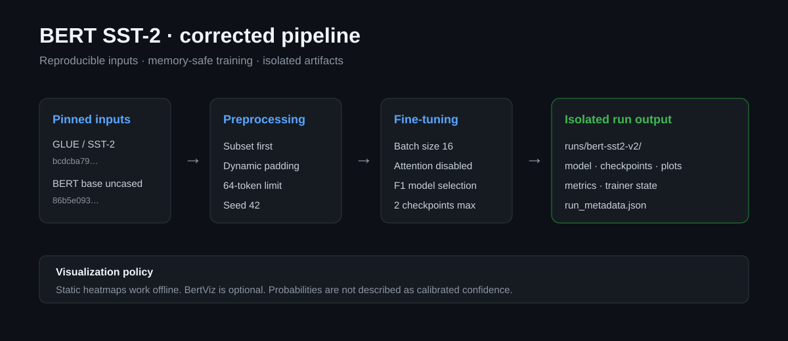

# BERT SST-2 Fine-Tuning & Multi-Head Attention Visualization

This repository fine-tunes `bert-base-uncased` for binary sentiment classification on the Stanford Sentiment Treebank (SST-2) using Hugging Face `transformers` and extracts multi-layer attention weights with static heatmaps (Seaborn/Matplotlib) and interactive views (BertViz).



---

## 1. Prerequisites & Windows Setup

> [!IMPORTANT]
> **Python recommendation:** Python 3.12 is recommended for broad ecosystem compatibility. Current PyTorch releases also publish Python 3.14 wheels, so Python 3.14 is not inherently blocked.

### Windows App Execution Alias Fix
If running `python` or `py` in PowerShell throws `"The file cannot be accessed by the system"`, Windows is attempting to execute the empty Microsoft Store alias:
1. Open **Settings > Apps > Advanced app settings > App execution aliases**.
2. Toggle **OFF** the aliases for `python.exe` and `python3.exe`.

### Environment Installation
Create and activate a virtual environment using Python 3.12:

```powershell
# Create virtual environment
py -3.12 -m venv .venv

# Activate environment (PowerShell)
.\.venv\Scripts\Activate.ps1

# Upgrade pip and install dependencies
python -m pip install --upgrade pip
python -m pip install -r requirements.txt

# Register kernel for Jupyter
python -m ipykernel install --user --name bert-sst2 --display-name "BERT SST-2 (Py3.12)"
```

*(Note for NVIDIA GPU users: If you have an NVIDIA GPU, install the CUDA-accelerated PyTorch build from the [official PyTorch selector](https://pytorch.org/get-started/locally/) prior to running).*

---

## 2. Usage Options

You can run this project either **interactively via Jupyter** or **headless via the CLI pipeline script**.

### Option A: Interactive Jupyter Notebook
Open `sst2_bert_attention_finetune.ipynb` in VS Code or JupyterLab, select the **BERT SST-2 (Py3.12)** kernel, and execute cells sequentially:
- Cell 1 verifies all required libraries and runtime device.
- Cell 2 tokenizes with dynamic padding and exposes an explicit, false-by-default `FAST_RUN` smoke-test switch.
- Cell 3 trains the model, tracks evaluation metrics (F1, Accuracy), and saves the weights.
- Cell 4 runs inference and extracts multi-head attention weights with `attn_implementation='eager'`.
- Cell 5 renders static 2D attention heatmaps and `[CLS]` token importance plots.
- Cell 6 attempts optional BertViz rendering without injecting third-party CDN scripts. Static plots remain the reliable offline path.

### Option B: Standalone Command-Line Script (`train_and_evaluate.py`)

A full CLI script is included to run training and attention analysis directly from your terminal:

```powershell
# Quick 1-minute smoke test (500 train samples, 1 epoch):
python train_and_evaluate.py --train --fast

# Full fine-tuning (all 67k samples, 2 epochs):
python train_and_evaluate.py --train --epochs 2

# Inference on a custom sentence + save attention plots to ./plots/:
python train_and_evaluate.py --predict "The movie was absolutely fantastic, but the acting was terrible." --save-plots
```

---

## 3. Project Architecture & Enhancements

- **Dynamic Padding:** Uses `DataCollatorWithPadding` to dynamically pad batches during collation, drastically reducing memory footprint compared to static dataset-wide max-length padding.
- **Fast Training:** Disables `output_attentions` during `Trainer.train()` to eliminate multi-head gradient graph retention, then re-enables eager attention during inference.
- **Strict Checkpoint Hygiene:** Configured with `save_total_limit=2` to prevent multi-gigabyte disk overflow.
- **Explicit Label Metadata:** Maps `0 -> Negative` and `1 -> Positive` directly in model configuration.
- **Static Heatmap Fallbacks:** Automatically plots 2D layer/head attention matrices and `[CLS]` importance bar charts without relying solely on notebook JavaScript rendering.
- **Scientific Caveat:** Attention matrices represent internal routing pathways; they do not constitute calibrated causal importance scores.
- **Pinned Sources:** The base model and GLUE dataset use immutable Hugging Face commit revisions.
- **Run Isolation:** New models, checkpoints, metadata, and plots are written below `runs/bert-sst2-v2/`; historical artifacts remain untouched.

Softmax values are reported as **predicted probabilities**, not calibrated confidence scores.

For the complete review, evidence, limitations, and validation record, see [docs/ANALYSIS.md](docs/ANALYSIS.md).

