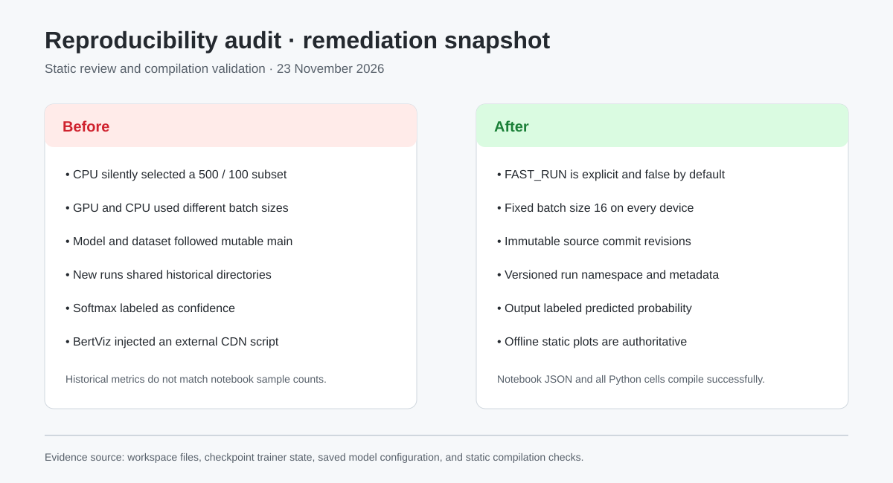

# Project analysis and remediation record

This audit supports an academic deep-learning project. Its purpose is to preserve experimental validity and traceability, not to impose production-deployment requirements. See [ACADEMIC_REPORT.md](ACADEMIC_REPORT.md) for the formal course-project narrative.

## Executive summary

The original workspace contained a single notebook, one final model, and one training checkpoint. The saved checkpoint recorded 125 training steps and evaluation over approximately 300 examples, while the old CPU notebook selected 500 training and 100 evaluation examples. The historical F1 score of `0.8746` therefore cannot be reproduced from the old notebook configuration.

The revised project separates historical artifacts from new runs, uses an explicit experiment mode, pins external model and dataset inputs to immutable revisions, and supplies both notebook and command-line workflows.

## Corrected problems

### Reproducibility

- `FAST_RUN` is false by default on CPU and GPU.
- Training batch size is fixed at 16 on every device.
- Random, NumPy, PyTorch, Trainer, and dataset shuffle seeds are fixed at 42.
- Base model is pinned to `google-bert/bert-base-uncased` commit `86b5e0934494bd15c9632b12f734a8a67f723594`.
- Dataset is pinned to `nyu-mll/glue` commit `bcdcba79d07bc864c1c254ccfcedcce55bcc9a8c`.
- Each completed run records its source revisions and hyperparameters in `run_metadata.json`.

### Performance and memory

- Fast-mode subsetting occurs before tokenization.
- `DataCollatorWithPadding` pads each batch dynamically.
- Attention tensors remain disabled during training and evaluation.
- The training model is released before the attention model is loaded.
- At most two checkpoints are retained.

### Inference and visualization

- Saved models contain `Negative` and `Positive` label mappings.
- Attention extraction explicitly uses the eager implementation.
- Softmax output is described as a predicted probability, not calibrated confidence.
- Static Matplotlib/Seaborn plots are the reliable offline visualization path.
- BertViz remains optional and no third-party RequireJS CDN is injected.

### Artifact isolation

- Historical directories remain untouched for provenance.
- Corrected runs write models, checkpoints, plots, metrics, and metadata below `runs/bert-sst2-v2/`.
- Generated artifacts are excluded from ordinary Git history because the checkpoint contains an 876 MB optimizer file and each model weights file is approximately 438 MB.

## Validation performed

- Parsed the notebook as valid notebook-format JSON.
- Compiled every notebook code cell successfully.
- Compiled `train_and_evaluate.py` successfully.
- Parsed both existing model configuration files and verified label mappings.
- Confirmed training-time attention is disabled.
- Confirmed the notebook and CLI use identical default sample counts, epochs, batch size, source revisions, and output namespace.

Full training was not rerun during remediation because the active interpreter does not currently contain PyTorch, Transformers, Datasets, Accelerate, scikit-learn, Seaborn, or BertViz. The historical model was preserved rather than overwritten.

## Remaining scientific limitations

- Seed control improves repeatability but does not guarantee bit-for-bit equality across CUDA hardware, drivers, or library builds.
- Attention weights show internal routing and are not causal feature attribution.
- Softmax probabilities are not calibrated unless a separate calibration procedure is performed.
- The 64-token truncation limit is suitable for SST-2 but would need reconsideration for longer-text datasets.
- Interactive BertViz rendering depends on notebook frontend support; static plots remain portable.

## Recommended verification run

1. Create the documented Python 3.12 environment.
2. Install `requirements.txt` and record the resolved environment with `python -m pip freeze`.
3. Run `python train_and_evaluate.py --train --fast` as a smoke test.
4. Confirm `runs/bert-sst2-v2/model/run_metadata.json` and evaluation metrics exist.
5. Run full training with `python train_and_evaluate.py --train --epochs 2`.
6. Generate plots with a custom sentence and inspect both saved PNG files.

## Provenance

Analysis completed on 24 November 2026. Source revisions were verified against the Hugging Face Hub. Existing binary artifacts were intentionally excluded from publication.

